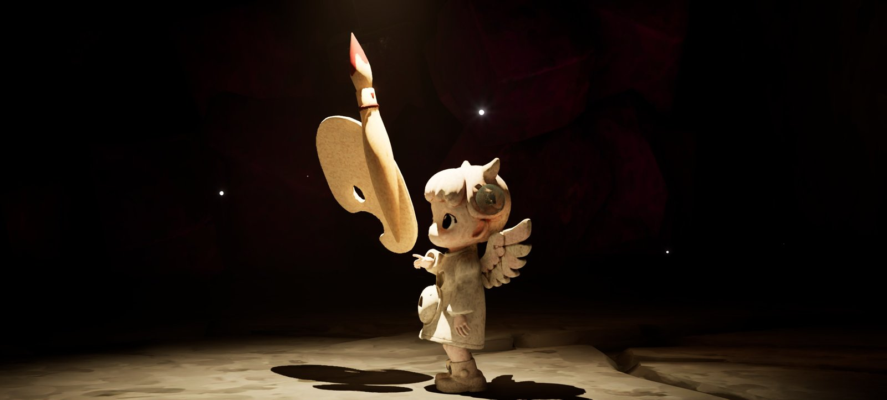
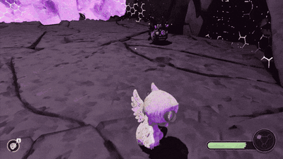
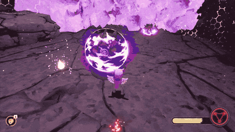
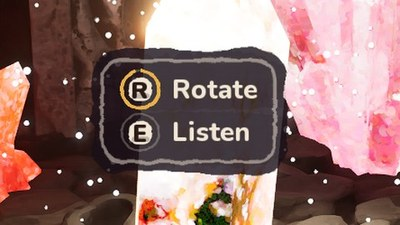

# The Painted Ascent — Prologue · Unreal Engine 5.8

**The Painted Ascent** is a personal project that I made from June to September 2026, in Unreal Engine 5.8.

It is not a commercial product. It is a project to learn and to try things: I made it to learn game development and to test new ways of working, from art to gameplay.

**All the art is mine.** Characters, props and environments **started as my own sketches, drawn by hand**. I improved them with FLUX.2 [klein] and made the first 3D models with Tripo AI. Then I cleaned and rigged the models in Blender, and retargeted the animations in Unreal.

**I designed and built all the programming**, only with Blueprints. I used Claude (Anthropic) as an assistant to review my work and to solve problems.

🎬 [Watch the gameplay video](https://www.youtube.com/watch?v=6CvP8dkcaxc)

> This repository shows the project: it has documents, diagrams and Blueprint graphs, but not the full project.

## Systems in detail

Here are some of the most interesting systems I made for this game. Each one has a short explanation and its Blueprint graph.

<table>
<tr>
<td width="33%" valign="top">

<h3><a href="systems/01-targeting-and-lunge.md">Reaching the enemies</a></h3>
To make the fight smooth, each hit of the combo chooses the best enemy to hit, and Motion Warping makes the attack longer so it reaches that enemy.
</td>
<td width="33%" valign="top">

<h3><a href="systems/03-ink-trail-material.md">Painted ink with alpha erosion</a></h3>
A visual effect based on alpha erosion: a noise makes holes in a brush-stroke texture, and a threshold cuts the result, so the trail looks painted with a dry brush.
</td>
<td width="33%" valign="top">

<h3><a href="systems/04-interaction.md">Object interaction</a></h3>
A system that divides every interaction between the player and the object: the object says what you can do, the character walks to it and plays the animation.
</td>
</tr>
</table>

## Development journal

A 17-page journal about design, art, animation, programming, effects and how I used AI in my work.

- 📄 [English](docs/Development_Journal_EN.pdf)
- 📄 [Italiano](docs/Development_Journal_IT.pdf)

## Contact

Giovanni Mantegna · gmantegna96@gmail.com
