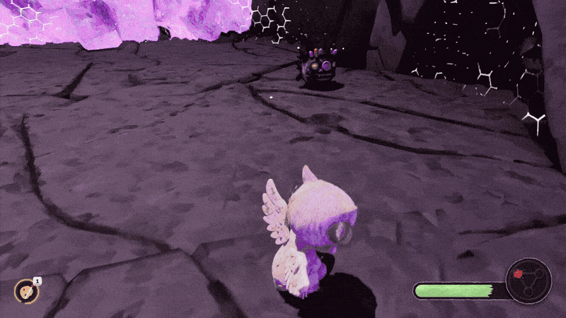
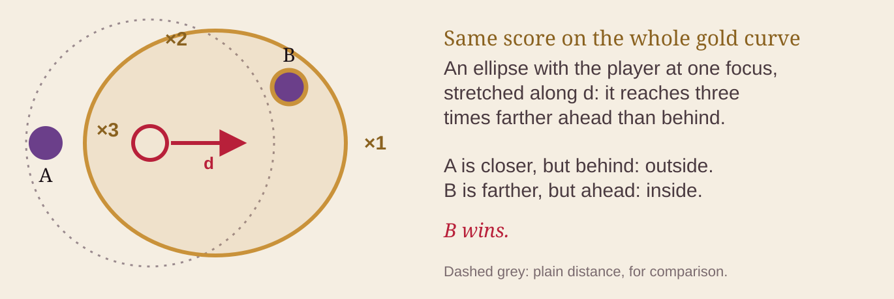
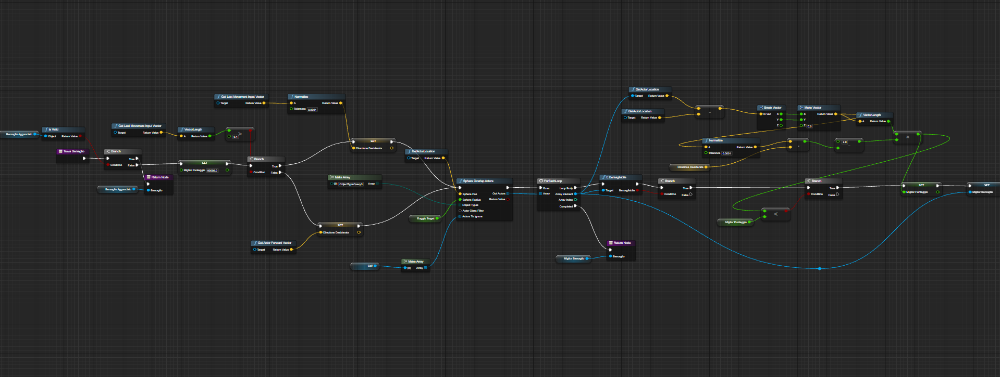
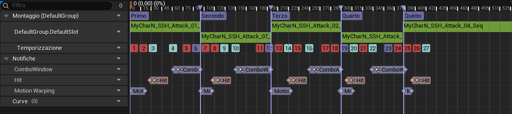
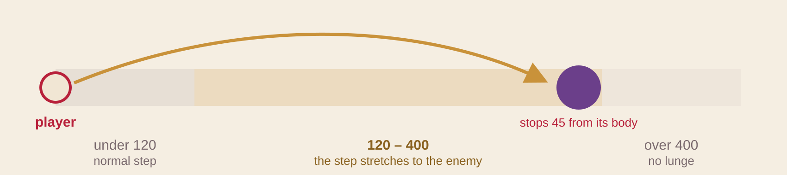

# Reaching the enemies

[← Back to the overview](../README.md)



*The Caster runs away, but every hit lands. The combo chooses it as the target, and Motion Warping makes each step longer to reach it. The player does not need to chase the enemy, so the combo does not stop and the fight feels better.*

In the first tests, it was very hard to hit the Casters. They are made to run away, and every hit pushed them back, so the brush often hit nothing. I solved this with two things:

1. at every hit of the combo, the character **chooses a target**;
2. the attack animation **becomes longer** to reach it.

Everything is made in Blueprints.

---

## 1 · Choosing the target: `TrovaBersaglio`

At every hit, `TrovaBersaglio` gives a score to each living enemy near the player. The enemy with the lowest score is the target. If the player locked an enemy with Tab, that enemy is always the target.

```math
\mathbf{v}_e = \left(p_e - p_{\text{self}}\right)_{xy}
\qquad
\hat{\mathbf{d}} =
\begin{cases}
\widehat{\text{input}} & \lVert \text{input} \rVert > 0.1 \\
\widehat{\text{forward}} & \text{otherwise}
\end{cases}
```

```math
s(e) = \lVert \mathbf{v}_e \rVert \,\bigl(2 - \hat{\mathbf{v}}_e \cdot \hat{\mathbf{d}}\bigr)
\qquad\qquad
e^{*} = \arg\min_{e \in E} \, s(e)
```

- **p** are positions: of the player (*self*) and of the enemy *e*. **v<sub>e</sub>** goes from the player to the enemy, on the ground (height is ignored). Its length is the distance.
- **d** is the direction where the player wants to go: the stick direction if the stick is pushed, otherwise the direction the character is looking.
- The **dot product** of these two directions is the cosine of the angle between them: 1 in front, 0 on the side, −1 behind.
- **2 − v̂<sub>e</sub> · d̂** (that is, 2 − cosine) becomes a multiplier: 1 in front, 2 on the side, 3 behind. So an enemy behind the player counts as three times farther away.

### What the score looks like



All the points with the same score make an **ellipse, with the player in one focus**, longer in the direction *d*. So the game prefers the enemy in the direction you are moving, even if it is not the closest one.

### The Blueprint

<a href="https://blueprintue.com/blueprint/fae_cgjh/"></a>

[](https://blueprintue.com/blueprint/fae_cgjh/)

In the graph, from left to right: if there is a Tab target, the function stops and returns it. Then it chooses *d* (stick or forward direction), finds the Pawns inside a sphere, and in a loop keeps only the living enemies (with the `EBersagliabile` interface). For each one it removes the height (Z = 0), computes the score and keeps the lowest.

---

## 2 · Reaching the target: Motion Warping

My first try moved the character with a Timeline. It looked like a teleport, and it worked against the movement of the animation (root motion). The solution was to let the animation do the work. Each attack already has a step forward: with **Motion Warping**, this step becomes longer until it reaches the enemy.



*The montage of the five-hit combo. In the Motion Warping row, each section has a warping window that ends just before its Hit notify.*



- Under 120 units the enemy is already close: normal step.
- Between 120 and 400 the step becomes longer, and stops 45 units from the enemy's body.
- Over 400: no long step.
- The distance is measured to the edge of the enemy's capsule, so the same rule works for the small Caster and for the very big Colossus. It works only on the ground.

After this change the fight was very different: the combo goes from one enemy to the next, without chasing them.

---

### References

- This kind of score is a common soft-targeting method in action games. To compare, see [UE5SoftTargetingSystem](https://github.com/Yhzan95/UE5SoftTargetingSystem): it adds weighted factors together, while I multiply the distance by a direction factor.
- Motion Warping: Steven Dickinson, [*Motion Warping in Gears of War 4: Doing More with Less*](https://gdcvault.com/play/1024219/Motion-Warping-in-Gears-of), GDC 2017.
