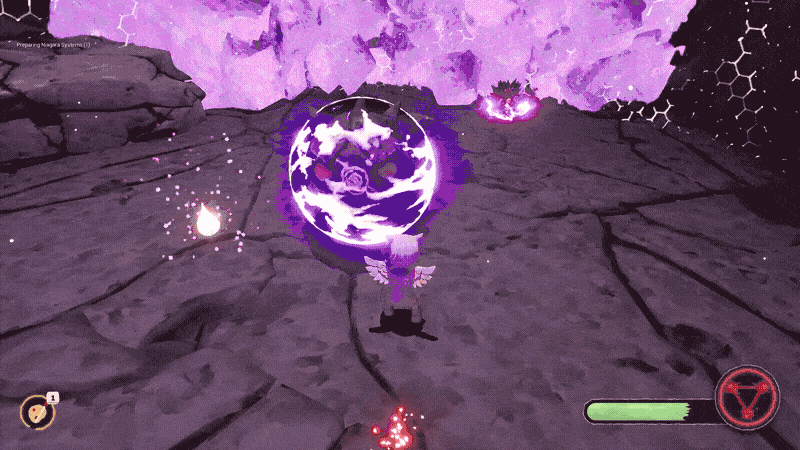
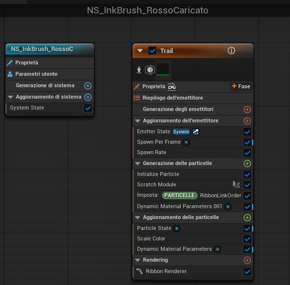
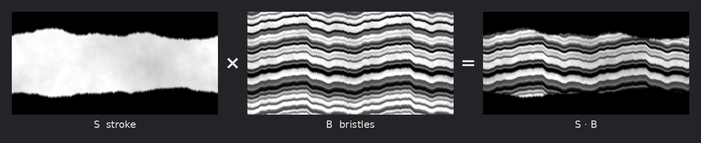
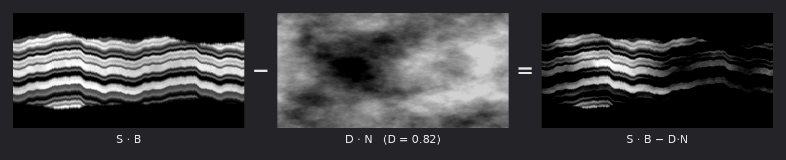
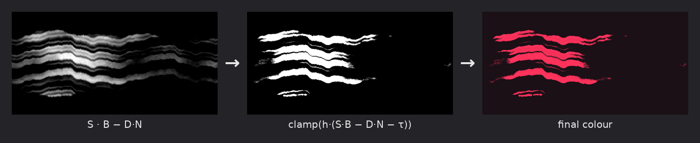

# Painted ink with alpha erosion

[← Back to the overview](../README.md)



*The special attack: when the ink seal is full, the angel goes up in the air and the brush paints bright strokes. The strokes stay in place for a moment, then break and disappear.*

This is the effect I like most. It has two parts: a **Niagara ribbon** that follows the brush, and **one custom material** that makes it look like real ink, painted with a dry brush and glowing.

---

## 1 · The ribbon

- **World space.** The trail stays where the brush passed. It looks painted in the air, not pulled behind the character.
- **The texture keeps the same size.** The texture repeats every 100 units along the trail. So a fast swing never stretches the brush stroke.
- **The life of the ink.** Each point of the trail lives 2 seconds. At the start it is dark and transparent. Then it becomes brighter and fuller towards the end of the trail (up to four times, in HDR, so the bloom makes it glow). At the end it breaks away all at once, instead of fading slowly.



## 2 · The material: alpha erosion

The painted look comes from three black-and-white textures: a brush **stroke** (S), the **bristles** (B) and a **noise** (N). The noise makes the edges irregular, like torn ink, and makes holes in the stroke. Then a threshold turns the soft result into hard edges, like a dry brush.

For every point *u* of the trail:

```math
\text{ink}(u) = \mathrm{clamp}\Bigl(h \cdot \bigl(S(u)\,B(u) \;-\; D\,N(u) \;-\; \tau\bigr),\; 0,\; 1\Bigr)
```

| Symbol | Meaning | Value |
|---|---|---|
| S, B, N | stroke, bristles, noise textures (from 0 to 1) | — |
| D | how strong the erosion is | ≈ 0.82 |
| τ | threshold | 0.35 |
| h | how hard the edges are | 8 |

Step by step, for each pixel:

1. **S · B**: the shape of the stroke, with the lines of the bristles.
2. **− D · N**: the noise makes holes where it is bright.
3. **− τ**: everything under the threshold disappears (the dry-brush look).
4. **· h**: the change from 0 to 1 becomes very quick, so the edges are sharp.
5. **clamp(…, 0, 1)**: the result stays between transparent (0) and full ink (1).

Each pixel is computed alone, only from the three textures in the same point: there is no blur.

### The same steps on the real textures

These are the three textures I use in the game, combined with the formula above (computed outside the engine, with the same values).

**1 · The bristles add lines to the stroke.** Where the bristles texture is dark, the stroke becomes dark too.



**2 · The noise makes holes.** When we subtract the noise, the ink disappears where the noise is bright, in big irregular areas.



**3 · The threshold cuts it.** Everything under τ disappears and the rest becomes solid: the soft greys become sharp, dry-brush edges. The colour is added at the end.



*In the game the final colour is in HDR, so the bloom makes it glow. Here it is shown flat.*

**An example with numbers** (D = 0.82, τ = 0.35, h = 8):

| Pixel | Computation | Result |
|---|---|---|
| centre of the stroke (S = 0.9, B = 1, N = 0.3) | (0.9 − 0.25 − 0.35) × 8 = 2.4 | **1**, full ink |
| on a dark bristle (S = 0.5, B = 0.7, N = 0.3) | (0.35 − 0.25 − 0.35) × 8 < 0 | **0**, transparent |
| edge (S = 0.7, B = 1, N = 0.4) | (0.7 − 0.33 − 0.35) × 8 ≈ 0.2 | **0.2**, thin edge |

The colour is a dark red, much brighter than 1, so the bloom makes it glow. The bristles make it darker in lines.

> [!NOTE]
> This is a **simpler version** of the real material. In the real graph the noise also moves the texture coordinates a little (this is what makes the edges look torn), and the stroke and the bristles are adjusted before they are combined. The idea is the same.

---

### References

- The name of this technique is **alpha erosion**: [Alpha Erosion – VFXDoc](https://vfxdoc.readthedocs.io/en/latest/shaders/alpha-erosion/).
- A visual explanation, step by step: [Stylized VFX in Unity, Part 1: Step, Smoothstep, Dissolve](https://torchinsky.me/stylized-vfx-unity-01/).
