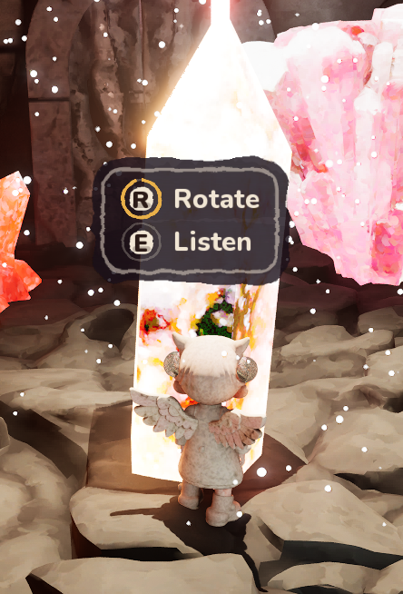
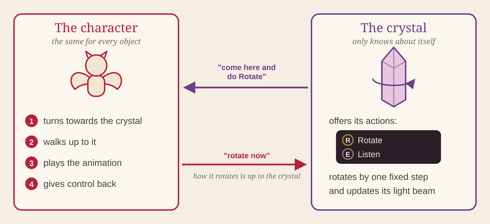
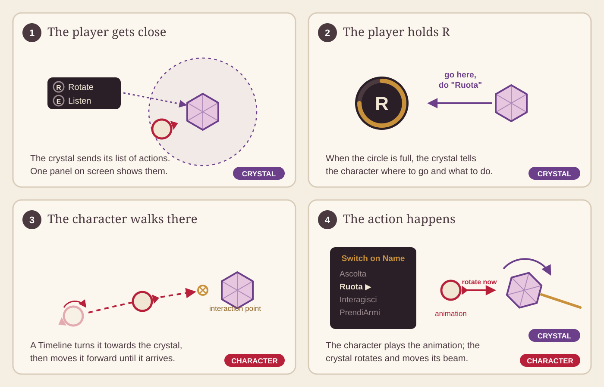
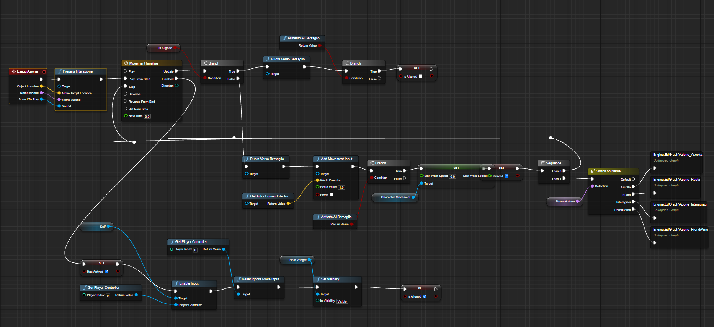

# Object interaction

[← Back to the overview](../README.md)

*Next to a crystal, the panel shows what you can do with this object. Hold R to rotate it, hold E to listen to it.*

The player can interact with objects in the world. The first ones are the crystals of the first puzzle: you can **listen** to a crystal, or **rotate** it to send a light beam to the next crystal. All the interactions in the level use this same system.

---

## The main idea: each side has its own job

Every interaction has two jobs. Each side does only its job, and does not know how the other side works.

| | Its job | In the crystal example |
|---|---|---|
| **The object** | Says *what* you can do with it, and does its own part | Shows "Rotate" and "Listen". When it must rotate, it turns on its axis by a fixed step and moves the light beam |
| **The character** | Does the part that is the same for every object: walks to it and plays the animation | Turns to the crystal, walks to it, plays the right animation |

The character does not know how a crystal works: it only says "rotate now", and the crystal decides how. The character does not know the keys either: the keys and the text on the panel come from the object.

### Why this is useful

- **New objects do not change the character.** A new object only has to say which actions it has. If it uses an action that already exists (for example "Listen"), the character does not change at all.
- **New actions are easy to add.** Every action has a name. To add one, you add that name as a new case in the **Switch on Name**, in the object and in the character.
- **The movement is written only once.** Walking to the object is the same for every action. Only what happens *after the character arrives* is different.

---

## How it works, step by step

1. **The player goes near the crystal.** The crystal sends its list of actions (key, text, name). There is only one panel in the whole game, and it shows the actions of the nearest object.
2. **The player holds R.** When the circle is full, the crystal tells the character where to go, which action to do and which sound to play.
3. **The character walks there.** A Timeline turns it to the crystal and moves it forward until it arrives. In this time the player cannot control the character.
4. **The action happens.** A **Switch on Name** chooses the action. For "Ruota" the character plays its animation and tells the crystal to rotate. Then the player can control the character again.

Why a Timeline and not *AI Move To*? *AI Move To* needs an AI controller to control the character, and when this happens the camera jumps to another position. With the Timeline the player controller keeps the control, so the camera does not move.

### The Blueprint

This is the character's side. On the left, the character gets ready and walks to the object. On the right, the Switch, with one collapsed graph for each action.

